<h1 align="center">Olá, eu sou o Ricardo Medeiros 👋</h1>

  <b>Infraestrutura de redes de provedor (ISP) + código para automatizar o que é repetitivo.</b> 
  Rio de Janeiro, Brasil · Estudando Análise e Desenvolvimento de Sistemas (ADS)

  
  

## 🙋 Sobre mim

- 🌐 Trabalho com infraestrutura de redes em provedor: administração de OLTs EPON/GPON, provisionamento de ONUs, switching Cisco Nexus (NX-OS), troubleshooting de PPPoE e suporte aos técnicos de campo.
- ⚙️ Automatizo a gestão de OLTs e ONUs pela API REST do equipamento: inventário de centenas de ONUs em planilha e, em andamento, um configurador em massa com modo de simulação (dry-run).
- 🔭 Próximo projeto: um app para os técnicos de estrutura registrarem a rota da fibra em manutenções e implantações.
- 📚 Estudando ADS e colocando em prática com projetos próprios, como os de baixo.
- 💬 Pode falar comigo sobre redes de acesso, automação de rede e React/TypeScript.

## 🚀 Projetos em destaque

| Projeto | O que é | Stack |
| --- | --- | --- |
| 💰 **[Finn](https://github.com/RicardoMedeiros1/FinanceDashbord)** [▶ abrir](https://ricardomedeiros1.github.io/FinanceDashbord/) | App de finanças pessoais instalável (PWA, funciona offline): gastos, cartões, contas, metas e investimentos. Importa extrato OFX/CSV, tem sincronização Open Finance opcional e login com 2FA obrigatório. | React · TypeScript · Vite · Supabase · Playwright |
| 🏋️ **[Treino ABC](https://github.com/RicardoMedeiros1/apptreino)** [▶ abrir](https://ricardomedeiros1.github.io/apptreino/) | Checklist de treino que roda no navegador do celular, sem backend: séries e repetições editáveis, progresso do treino e cronômetro de descanso. | HTML · CSS · JavaScript |
| 🧑‍💻 **[Portfólio](https://github.com/RicardoMedeiros1/meuportfolio)** [▶ abrir](https://ricardomedeiros1.github.io/meuportfolio/) | Meu site pessoal com apresentação, formação e histórico profissional. | HTML · CSS |

## 🛠️ Tecnologias

| Área | |
| --- | --- |
| **Front-end** |        |
| **Back-end e dados** |       |
| **Testes e DevOps** |     |
| **Redes e infra** |      |
| **Ferramentas** |     |

## 📊 Estatísticas

  
  

  

